# Práctica DuckDB - Charla Técnica Javier

Alumno/a: Sara Antón Madero

# Parte 1: Creación de la base de datos con Python

## PASO 1: Instalación de la librería

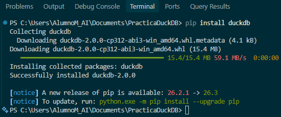

## PASO 2: Ingesta del CSV y creación de la base de datos

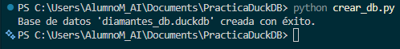

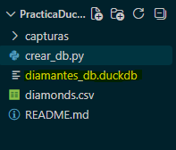

# Parte 2: Conexión y Exploración en DBeaver

## PASO 3: Conectar la base de datos

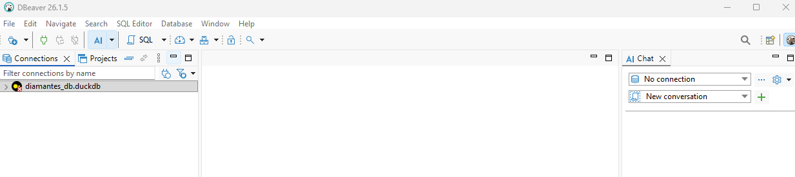

# Parte 3: Análisis de Datos y Consultas SQL

## PASO 4: Validación de la estructura y volumen de datos

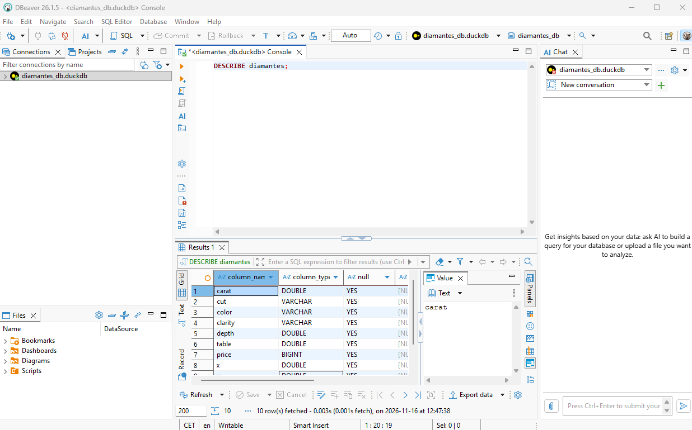

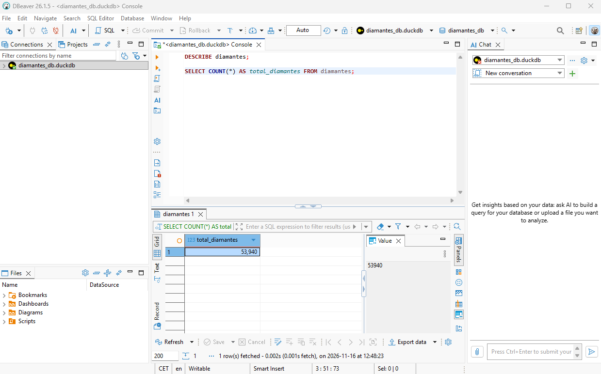

## PASO 5: Análisis Exploratorio (EDA) - Rentabilidad por corte

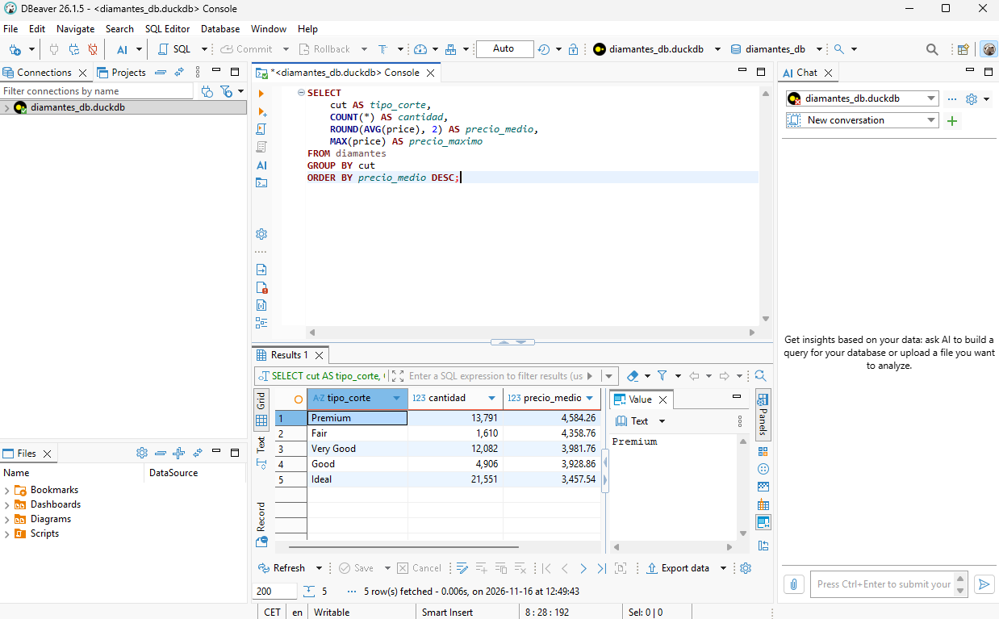

## PASO 6: Análisis Estadístico Masivo con SUMMARIZE

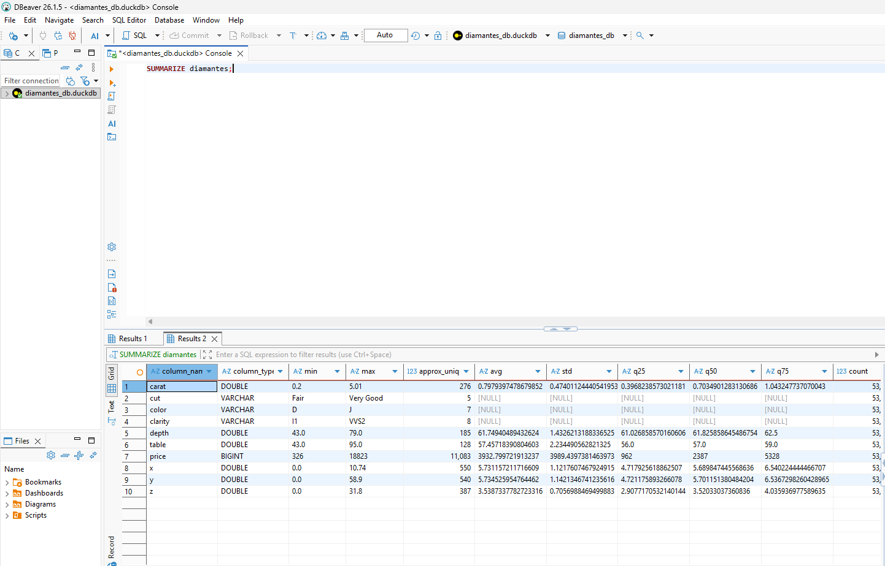

# Parte 4: El ecosistema Big Data (Parquet)

## PASO 7: Exportación a Parquet

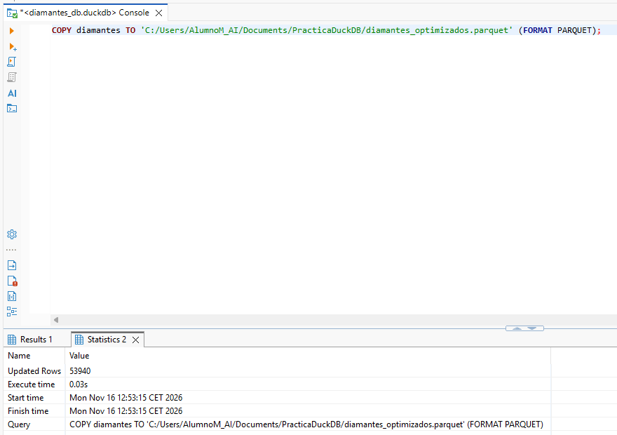

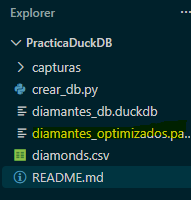

## PASO 8: Consulta directa a un Data Lake (Archivos Parquet)

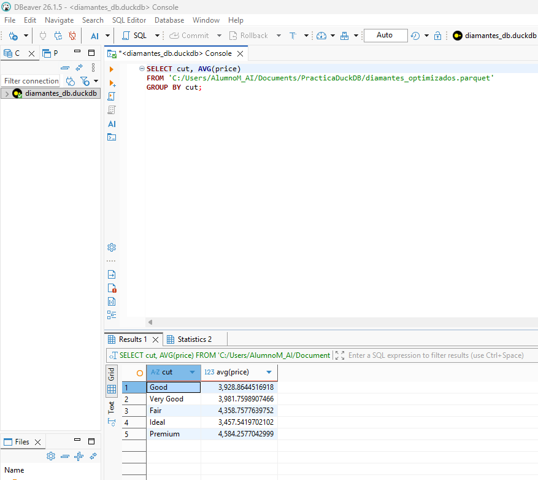
